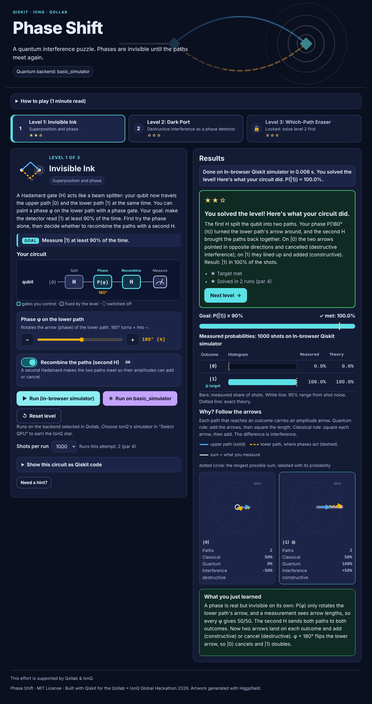
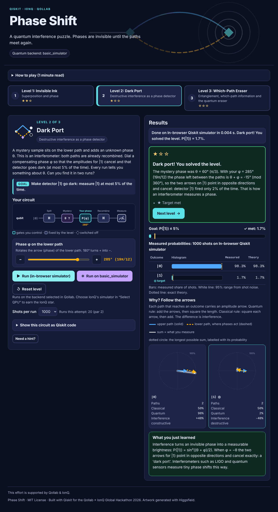
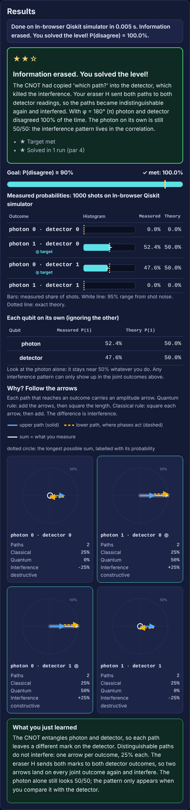
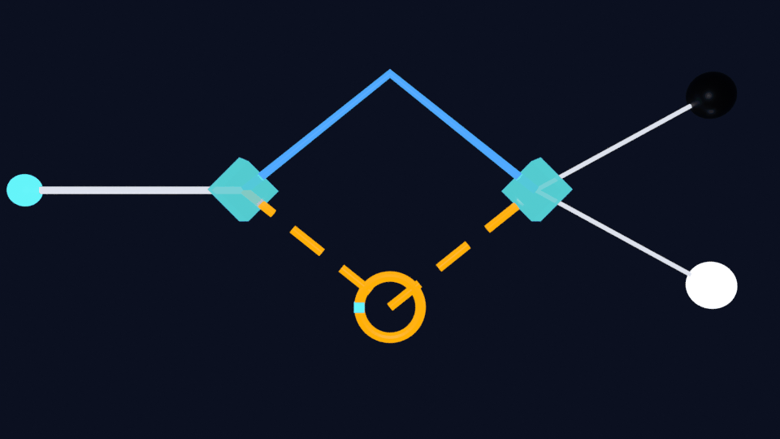

# Phase Shift: a quantum interference puzzle

This effort is supported by Qollab & IonQ.

**Theme:** Quantum Playground (+ Quantum Unlocked) · **License:** MIT (see [LICENSE](LICENSE)) · **Hackathon:** Qollab × IonQ Global Hackathon, Oct 9–11, 2026 · **Framework:** Qiskit 2.x · **Runs on:** Qollab's free simulators, including IonQ's

> Steer an invisible phase until a qubit's two paths meet and add up, or cancel out, to hit a target measurement probability. Then confirm your solution on IonQ's simulator.

* Qollab project page: _add your link here_
* Demo video (2–3 min): _add your YouTube link here_



## What it is

Phase Shift is a three-level puzzle game about **interference**, the effect that makes quantum computers more than random-number generators. In every level you change a real Qiskit circuit (Hadamard gates, a phase gate, a CNOT) and run it. You only win by making probability amplitudes **add up or cancel**: flipping fair coins cannot reach any of the targets.

After every run the game shows:

* a **histogram** of the measured outcomes with 95% error bars (shot noise) and the exact theory value;
* a **goal meter** for the level's target;
* **"Follow the arrows"**: for each outcome, every path through *your* circuit drawn as an amplitude arrow, with the **classical** prediction (square each arrow, then add), the **quantum** result (add arrows, then square) and the **interference term** (the difference). This exact path sum (Feynman's "arrows" picture) is computed by `phaseshift/paths.py` from the player's circuit and explains all three levels with one rule: *one arrow per outcome, no interference; two arrows, interference.*

| Level | Concept | Your controls | Goal |
|---|---|---|---|
| 1. Invisible Ink | Superposition and phase: a phase alone is invisible to measurement | phase φ, second H on/off | P(\|1⟩) ≥ 90% |
| 2. Dark Port | Destructive interference as a phase detector (hidden phase, par 2 runs) | phase φ | P(\|1⟩) ≤ 5% |
| 3. Which-Path Eraser | Entanglement destroys interference; erasing which-path information restores it in the correlations | phase φ, eraser H on/off | P(photon ≠ detector) ≥ 90% |

Stars: ★ solved · ★ within par runs · ★ confirmed on IonQ's simulator. Solving a level unlocks the next.

Full design (learning objectives, every level's circuit, physics, hints and feedback): [docs/GAME_DESIGN.md](docs/GAME_DESIGN.md).

| Dark Port, solved | Which-Path Eraser, results | 3D interferometer (video asset) |
|---|---|---|
|  |  |  |

## How to run on Qollab

1. Open the project on Qollab in **Chrome or Edge** (the in-browser Python runtime needs WebAssembly JSPI; recent Firefox also works, Safari does not).
2. Press **Run** and choose **IonQ's simulator** in *Select QPU* (the built-in simulator works too).
3. Wait for "Quantum backend: … (IonQ)" under the title. The first load of Python and Qiskit takes a few seconds.
4. Play: set the gates, press **▶ Run (in-browser simulator)** as often as you like. These practice runs use Qiskit's simulator inside your browser.
5. When a level is solved, press **⚛ Confirm on IonQ**. Your exact circuit goes to IonQ's simulator as **one job**. Qollab allows one IonQ job per Run, so the button then locks. Press **Stop**, then **Run**, to send another. Your progress and circuit are saved in the browser, so nothing is lost.

If no backend is selected, the game stays in practice mode and says so.

## How to play

* **H** splits the qubit into two paths: the *upper path* |0⟩ and the *lower path* |1⟩.
* **P(φ)** rotates the lower path's amplitude arrow. It never changes the arrow's length, so on its own a measurement cannot see it.
* **Measurement** gives each outcome with probability = (length of that outcome's total arrow)².
* **Interference**: when two paths lead to the same outcome, their arrows add head to tail. Same direction → brighter; opposite → dark.

Every control is keyboard accessible: Tab moves between controls, the arrow keys turn the phase dial, the − and + buttons step it by 15°, and Space toggles a gate.

## Run it locally

```bash
pip install -r requirements-dev.txt      # qiskit, qiskit-aer, qiskit-ionq, pytest, pillow

# The real web UI, backed by real Python + Qiskit:
python dev/server.py                     # open http://127.0.0.1:8000/dev/index.html
python dev/server.py --backend aer       # "selected backend" = Qiskit Aer
IONQ_API_KEY=... python dev/server.py --backend ionq [--noise aria-1]   # IonQ's cloud simulator
python dev/server.py --backend none      # like Qollab with no QPU selected

# Command line (no browser):
python -m phaseshift                     # every level: a first try and the solution
python -m phaseshift --level invisible-ink --phi 180 --on recombine
IONQ_API_KEY=... python -m phaseshift --backend ionq --noise forte-1

pytest                                   # 143 tests: physics, path sums, API, IonQ serialization
```

`dev/index.html` wraps the same body-only `index.html` that Qollab uses and maps the module name `phaseshift.api` to `dev/py-shim.js`, which forwards calls to `dev/server.py`. The page code is identical in both places.

The notebook [notebooks/phase_shift_walkthrough.ipynb](notebooks/phase_shift_walkthrough.ipynb) walks through the physics of each level with plain Qiskit, including a φ sweep plot and an optional IonQ cell.

## How it works (hybrid quantum + classical)

```
 Browser (Qollab page)                         Python (Pyodide on Qollab, CPython locally)
 ┌───────────────────────────┐   positional    ┌──────────────────────────────────────────┐
 │ index.html  main.css       │  callPromising  │ phaseshift/api.py      plain-dict facade  │
 │ main.js  (orchestrator)    │ ─────────────▶  │ phaseshift/levels.py   level data         │
 │ web/render.js (SVG, table) │                 │ phaseshift/circuits.py → QuantumCircuit   │
 │ web/bridge.js (calls)      │ ◀─────────────  │ phaseshift/paths.py    exact arrows       │
 │ web/store.js (progress)    │   toJs(dict)    │ phaseshift/execution.py run + counts      │
 └───────────────────────────┘                 │ phaseshift/game.py     solve, stars, text │
                                               └──────────────┬───────────────────────────┘
                          where="local": BasicSimulator (in the browser, unlimited)
                          where="backend": Qollab's injected `backend` (IonQ simulator: 1 job per Run)
```

* **Quantum part:** each run builds one 1- or 2-qubit Qiskit circuit from the level and the player's settings, compiles it without re-optimisation (`optimization_level=0`, so IonQ runs exactly H–P–H, translated to IonQ's gate set, P → RZ), and runs it for 250–2000 shots.
* **Classical part:** the UI, the exact path sum, statistics (Wilson intervals), solve checks, feedback text and progression.
* **IonQ on Qollab:** the platform creates `backend` from *Select QPU*; the page passes it to `run_level(backend, …)`. The module never creates a backend. A per-backend-object guard turns a second IonQ job in the same Run into a friendly message instead of an error.
* **IonQ locally:** `phaseshift.execution.ionq_backend()` uses `qiskit-ionq` with `IONQ_API_KEY` (optional `noise_model`). A test serializes every level's compiled circuit with `qiskit_ionq.helpers.qiskit_to_ionq` to check IonQ compatibility offline.

## Repository layout

```
index.html  main.js  main.css   Qollab page: body-only HTML, orchestrator (static Python import), styles
web/                            UI modules: bridge.js, render.js, store.js, art.js, art-data.js
phaseshift/                     Python package ("src"): levels, circuits, paths, execution, game, api, CLI
tests/                          pytest suite (physics, API, IonQ serialization, progression)
notebooks/                      Jupyter walkthrough with outputs
dev/                            local dev server + Pyodide shim (not uploaded to Qollab)
tools/                          package_qollab.py, embed_art.py, build_notebook.py
assets/                         Higgsfield artwork manifest (prompts, job ids) and generated files
docs/                           game design, developer guide, Qollab page text, video script, 3D plan
```

Qollab requires `index.html`, `main.js` and `main.css` at the project root, so they live there rather than in `web/`.

## Publish on Qollab

```bash
python tools/package_qollab.py     # -> dist/phase-shift-qollab.zip
```

The script zips only the runtime files (page, `web/*.js`, `phaseshift/*.py`, `requirements.txt`, README, LICENSE). It checks the limits other teams reported (at most 100 files, each under 2 MB, README under 65,000 characters), scans for secrets, and checks that `main.js` keeps its static import and final keep-alive line. Upload the zip as a **JS + Qiskit** project, choose the **MIT** license, paste [docs/QOLLAB_PROJECT_PAGE.md](docs/QOLLAB_PROJECT_PAGE.md) into the project page, and add the video link.

## Extend it

Add a level by appending a `Level` to `phaseshift/levels.py` (gates, controls, target, hints) and a feedback writer in `phaseshift/game.py`; the UI builds itself from `api.info()`. Ideas and step-by-step instructions: [docs/DEVELOPER_GUIDE.md](docs/DEVELOPER_GUIDE.md).

## Accessibility

* WCAG 2.1 AA contrast in a dark theme; visible focus outline on every control; skip link.
* Native, keyboard-operable controls (range input with `aria-valuetext` such as "135° (3π/4)", ±15° step buttons, `role="switch"` checkboxes).
* Every chart has a text equivalent: the histogram **is** a data table (bars are decoration), and each arrow diagram has a full description of its arrows, directions and result.
* Colour is never the only signal: the two paths differ by colour **and** line style, and targets are marked with text.
* A polite live region announces each run's result without moving focus; `prefers-reduced-motion` and forced-colours modes are respected.
* Checked with axe-core (WCAG 2.1 A/AA + best practices): 0 violations on load and after runs in levels 1 and 3.

## Artwork and 3D

Level illustrations and the header banner were generated with **Higgsfield** (Recraft V4.1). Prompts, job ids and the palette are in [assets/higgsfield_manifest.json](assets/higgsfield_manifest.json); [assets/ARTWORK.md](assets/ARTWORK.md) explains how to regenerate them and embed them with `tools/embed_art.py`. Without them the game uses its own SVG emblems. Optional 3D assets for the video (Blender): [docs/BLENDER_3D.md](docs/BLENDER_3D.md).

## Demo video

Script, storyboard, voiceover and recording/publishing steps: [docs/VIDEO_SCRIPT.md](docs/VIDEO_SCRIPT.md).

## Credits, prior work and AI disclosure

* All code, text and assets were created during the hackathon window (see the commit history).
* Platform integration follows what other teams documented publicly during this hackathon: the static `import * as api from "<module>"` pattern, the keep-alive `await` at the end of `main.js`, and the single-circuit / one-job-per-Run IonQ rule. See *Entangle the Andes* (AGONIXX15/quantum_project_qollab) and *Quantum MagNav* (aaasocial/quantum-magnav). No code was copied.
* Built with the help of **Claude Code** (Anthropic) for code, tests, UI and documentation, directed and reviewed by the team.
* Third-party software: [Qiskit](https://github.com/Qiskit/qiskit) (Apache-2.0), [qiskit-ionq](https://github.com/qiskit-community/qiskit-ionq) (Apache-2.0, local development), [qiskit-aer](https://github.com/Qiskit/qiskit-aer) (Apache-2.0, optional), NumPy (BSD-3), Pyodide (MPL-2.0, provided by Qollab).
* Physics: R. P. Feynman, *QED: The Strange Theory of Light and Matter* (1985), for the arrow picture; M. O. Scully & K. Drühl, *Phys. Rev. A* 25, 2208 (1982), for the quantum eraser; E. B. Wilson, *JASA* 22, 209 (1927), for the score interval.

## License

MIT. See [LICENSE](LICENSE).
